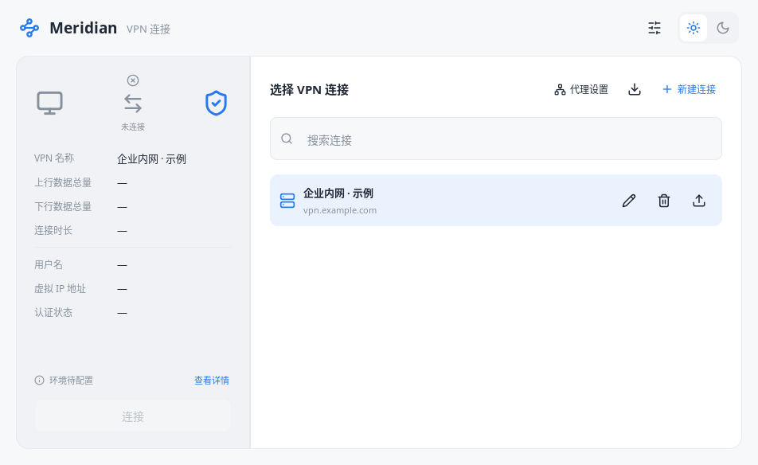
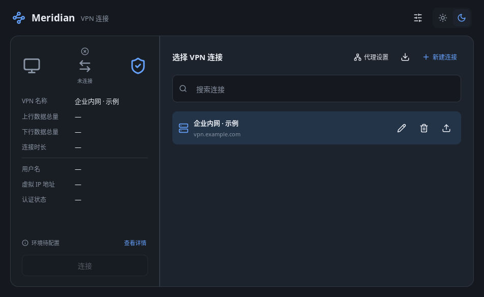
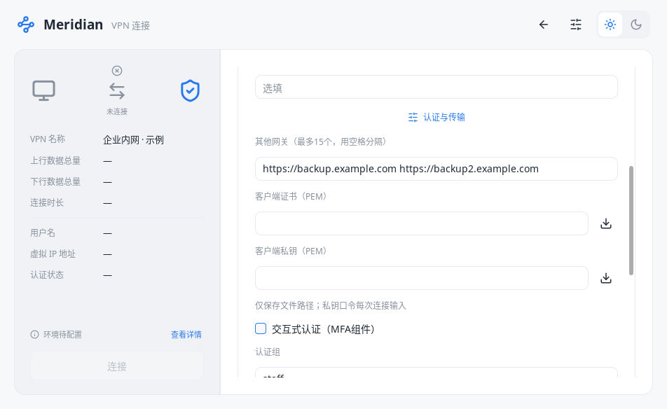
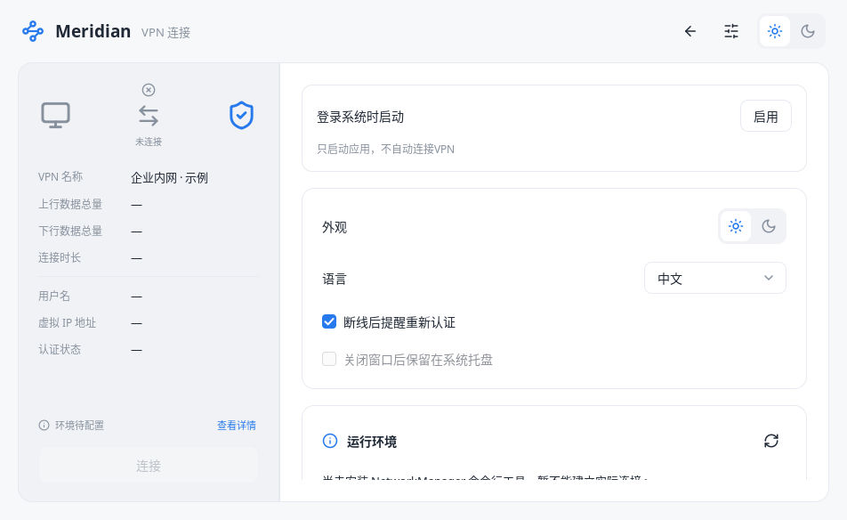
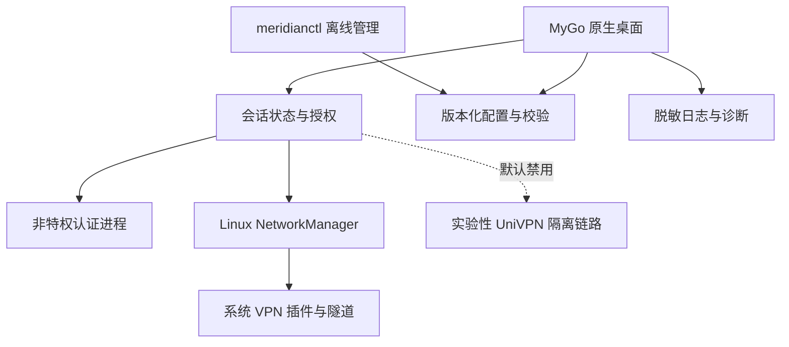

<div align="center">

# Meridian

### 原生桌面 · 清晰授权 · 可追溯验证

基于 Go 与 MyGo 的安全访问客户端，面向 Linux VPN 工作流与跨平台原生界面。

[](https://github.com/alanbulan/meridian-vpn/actions/workflows/ci.yml)


[界面预览](#界面预览) · [平台与协议](#平台与协议) · [快速开始](#快速开始) · [工程验证](#工程验证) · [安全边界](#安全边界) · [开发路线](#开发路线)

</div>

Meridian 使用纯 Go 原生桌面界面，不依赖 WebView、HTML、JavaScript、Electron、Tauri 或 Wails。配置管理、认证交互与系统连接分层实现；界面明确区分缺少依赖、等待授权、正在连接、连接失败和清理失败。

> **开发阶段说明**：Linux 已有 AnyConnect/OpenConnect 与 NetworkManager L2TP/IPsec 后端代码，尚未完成真实企业网关、内网访问和路由/DNS 恢复验收。Windows 与 macOS 当前提供界面及离线 CLI，**没有 VPN 后端**。实验性 UniVPN 默认禁用。本项目尚不是可替代任意企业 UniVPN 部署的生产客户端。

## 界面预览

以下为归档中的真实 Linux 原生窗口截图，使用示例配置；它们展示界面，不代表本次 CI 或真实隧道验收结果。

| 浅色界面 | 深色界面 |
| --- | --- |
|  |  |

<details>
<summary><strong>高级设置与配置管理</strong></summary>




</details>

## 桌面工作流

| 连接与配置 | 认证与授权 | 本地工具 |
| --- | --- | --- |
| 配置新建、编辑、搜索、确认删除 | 密码、PEM、PKCS#12 与受限 PKCS#11 URI 输入 | Meridian JSON 导入预览、去重与导出 |
| 手动多网关选择与安全切换 | 路由/DNS 变更逐次确认 | 只读环境诊断与脱敏日志导出 |
| 中文 / English、浅色 / 深色主题 | 可选独立 libopenconnect MFA 组件 | 无界面 `meridianctl` 配置管理 |
| 已验证接口的地址、流量与连接时长 | 取消认证、清除会话秘密、失败关闭 | Linux 用户级登录启动的确认流程 |

密码、Cookie、私钥口令和 PIN 不写入配置文件。代理集成认证单次授权不会随配置导入或持久化。托盘功能取决于桌面宿主；不支持时明确禁用。

## 平台与协议

| 平台 / 能力 | 当前实现 | 验证边界 |
| --- | --- | --- |
| Linux amd64 原生界面 / CLI | 已实现 | CI 构建、单元测试、CLI 启动；归档另有原生 GUI 人工记录 |
| Linux AnyConnect | OpenConnect 认证 + NetworkManager 系统服务 | 本地合成身份认证夹具有记录；真实企业隧道未验收 |
| Linux L2TP/IPsec | NetworkManager-l2tp 参数及生命周期适配 | 受控测试；真实 IKE/PPP 协商、授权及清理未验收 |
| Linux 实验性 UniVPN | 原生传输、broker 与隔离组件的开发代码 | 默认禁用；仅受控/回环夹具与离线准备，非生产连接入口 |
| Windows amd64 | 原生界面与离线 CLI | 无 VPN 后端，无签名安装包；以对应 Actions 结果判断原生编译/测试 |
| macOS arm64 | 原生界面与离线 CLI | 无 VPN 后端，无 Developer ID 签名/公证；以对应 Actions 结果判断原生编译/测试 |

PKCS#11 输入支持不等于硬件令牌兼容认证。结构化 MFA 不等于厂商 SSO、Host Checker、网页认证或终端合规支持。详见[证书认证](docs/CERTIFICATE-AUTHENTICATION.md)、[L2TP/IPsec](docs/L2TP-IPSEC.md)与[功能覆盖](docs/REFERENCE-COVERAGE.md)。

## 快速开始

### 构建原生界面与 CLI

需要官方 **Go 1.27.3 或以上**，精确依赖见 [go.mod](go.mod) 与 [go.sum](go.sum)。Linux 原生界面需要 GTK3、Pango、Fontconfig 等系统运行库，不需要 WebKit。

```sh
go version
go mod download
go mod verify
make check
make build
./build/meridian
```

无 GPU 桌面可使用 MyGo CPU 渲染器；使用独立配置文件进行界面检查：

```sh
MYGO_GPU=0 ./build/meridian --config /tmp/meridian-qa/profiles.json
```

默认配置保存在 `os.UserConfigDir()/meridian/profiles.json`。Linux 与 macOS 可使用 Makefile；Windows 开发环境也可直接运行 Go 命令：

```sh
go build -buildvcs=false -trimpath -tags mygo_noinspector -ldflags "-s -w -X github.com/egoist/mygo.production=1" -o build/meridian.exe ./cmd/meridian
go build -buildvcs=false -trimpath -o build/meridianctl.exe ./cmd/meridianctl
```

`make cross` 可交叉编译 Windows amd64 与 macOS arm64 界面。交叉编译与目标系统运行是不同验证阶段。

### Linux 连接前准备

由管理员通过发行版包管理器安装和维护 OpenConnect、NetworkManager、对应的 OpenConnect 或 L2TP/IPsec 插件，以及正常的 D-Bus / Polkit 桌面授权环境。应用不自动安装依赖、不调用 sudo，也不要求以 root 启动 GUI。

1. 从 IT 获取授权网关、协议及认证要求。
2. 新建配置，在设置页检查依赖。
3. 发起连接，输入本次凭据并明确确认路由/DNS 变更。
4. 系统服务建立连接；退出或切换前等待旧会话清理结果。

实际连接会改变系统网络，请只在获授权的环境执行。依赖存在、认证成功或进程启动均不等于隧道与内网已经可用。

### 离线命令行

```sh
./build/meridianctl help
./build/meridianctl version
./build/meridianctl --config ./profiles.json profiles list --json
./build/meridianctl --config ./profiles.json validate --json
./build/meridianctl diagnostics --json
```

CLI 不提供连接、断开或密码输入。诊断只检查依赖与就绪状态，存在阻断项时返回退出码 1。导出文件可能含网关、账号和本地路径，分享前仍需审阅。完整命令见 [CLI 文档](cmd/meridianctl/README.md)。

## 技术架构



| 层级 | 实现入口 | 职责 |
| --- | --- | --- |
| 原生界面 | [internal/desktop](internal/desktop) | 页面、认证交互、导入导出、生命周期提示 |
| 会话与协议适配 | [internal/core](internal/core) | 配置校验、授权、认证、连接状态和回滚 |
| 无界面管理 | [cmd/meridianctl](cmd/meridianctl) | 离线配置、INI 结构预览、只读诊断 |
| 系统辅助能力 | [internal/autostart](internal/autostart)、[internal/diagnostics](internal/diagnostics) | 启动项与有限、脱敏的环境报告 |
| 实验性隔离 | [internal/processcontainment](internal/processcontainment)、[integration/worker-bootstrap](integration/worker-bootstrap) | cgroup 生命周期契约、受限 worker 启动代码与注入测试 |
| 离线部署准备 | [integration/provisioning](integration/provisioning) | 清单、哈希、文件类型与工作区暂存；不安装、不激活 |

详细信任边界见[架构说明](docs/ARCHITECTURE.md)与[安全说明](docs/SECURITY.md)。

## 工程验证

[GitHub Actions](.github/workflows/ci.yml) 在 Linux amd64、Windows amd64、macOS arm64 原生 runner 上分别执行：

- 固定 Go 版本、模块完整性检查。
- `go test -count=1 -json ./...` 与 `go vet ./...`。
- 目标平台 GUI / CLI 编译，以及不读取配置的 CLI `help` / `version` 启动。
- 独立输出测试记录和未签名开发二进制，保存 7 天。
- Linux 追加 race 检查、静态 bootstrap 构建/注入测试、离线 provisioning 单元测试。

工作流汇总单独列出跳过项，跳过不计为通过。GUI 单元测试使用 MyGo `ui.NewTester`，不能代替真实窗口、托盘、输入法、系统授权弹窗或登录启动验收。CI 不创建实际 TUN、不修改路由/DNS、不连接企业网关、不安装或运行特权 UniVPN 服务。

```sh
go test -count=1 ./...
go vet ./...
CGO_ENABLED=1 go test -race -count=1 ./...
make -C integration/worker-bootstrap all test
python3 -m unittest discover -s integration/provisioning -v
```

发布 GUI / CLI 使用 `CGO_ENABLED=0`；race 检测需要的 cgo 仅用于测试插桩。可选认证 helper 是单独的 C 程序，不能称为全 Go VPN 协议实现。

本地合成认证、回环 TLS 和原生 C 回归的复现入口分别见 [authfixture](integration/authfixture/README.md)、[mfa-helper](integration/mfa-helper/README.md)、[univpn-native](integration/univpn-native/README.md)。这些测试不在基础 CI 中自动启用；外部依赖必须独立核验。

历史验证记录保存在 [VALIDATION.md](docs/VALIDATION.md)，属于对应检查点，不自动继承到后续代码。最新运行是否通过，以具体 commit 的 Actions 日志为准。

## 安全边界

- 凭据只用于当前认证会话；不把密码、Cookie、PIN 或私钥口令写入配置、日志、argv 或环境变量。
- 系统连接只操作本次创建的配置身份，失败时保留清理不确定性的提示，并阻止不安全的重复连接。
- 不提供 kill switch 或完整 IPv6 / DNS 泄漏保证。强制结束应用、系统崩溃时，系统服务中的连接不保证立即断开。
- 实验性 UniVPN 仍缺可信部署、独占网络控制与真实内核隔离验收；不要安装为 setuid、手动运行 bootstrap 或启用生产连接。
- 离线清单哈希证明字节一致，不证明代码安全、来源可信或完整依赖闭包。

发现问题时请勿提交真实账号、网关、Cookie、私钥、证书口令或完整网络配置。

## 开发路线

- [ ] 在授权隔离环境验收 Linux 真实隧道、内网访问、路由/DNS 回滚和异常退出。
- [ ] 验证实验性 worker 的真实内核隔离、资源限制、失败回收和不可逃逸性。
- [ ] 实现 Windows / macOS 平台后端及其权限、安全服务与签名流程。
- [ ] 完成真实桌面窗口、托盘、输入法与登录启动的目标系统验收。
- [ ] 按明确需求实现 SSO、硬件令牌、自动重连和系统密钥环，而非用界面选项替代能力。

详细缺口与验收条件见[剩余工作](docs/REMAINING-WORK.md)。

## 依赖与许可

MyGo 与 Lucide 的许可证副本随源码保留；Go 依赖通知见 [docs/third-party](docs/third-party)。实验性原生代码包含 OpenConnect 上游源码与补丁，沿用其 LGPL-2.1 及相关通知；不能因部分外围代码采用 MIT 就将整个项目或原生核心标为 MIT。

现有归档未包含 Meridian 自有代码的顶层许可证，仓库公开不等于授予统一开源许可。正式发布前需由维护者确认项目许可，并核对各分发资产的许可证、对应源码及替换/重新链接义务。详见 [THIRD_PARTY.md](THIRD_PARTY.md)。

## 反馈与贡献

反馈请注明操作系统、架构、commit、复现步骤和脱敏日志，区分编译失败、界面问题、认证失败与真实网络问题。提交改动时补充回归测试，并明确记录哪些检查通过、失败或未运行。
